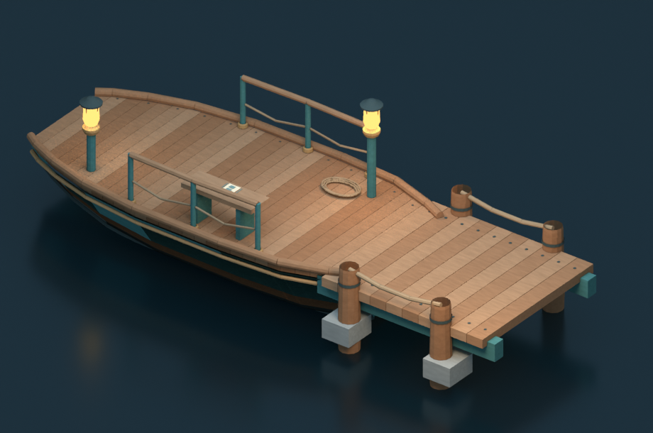
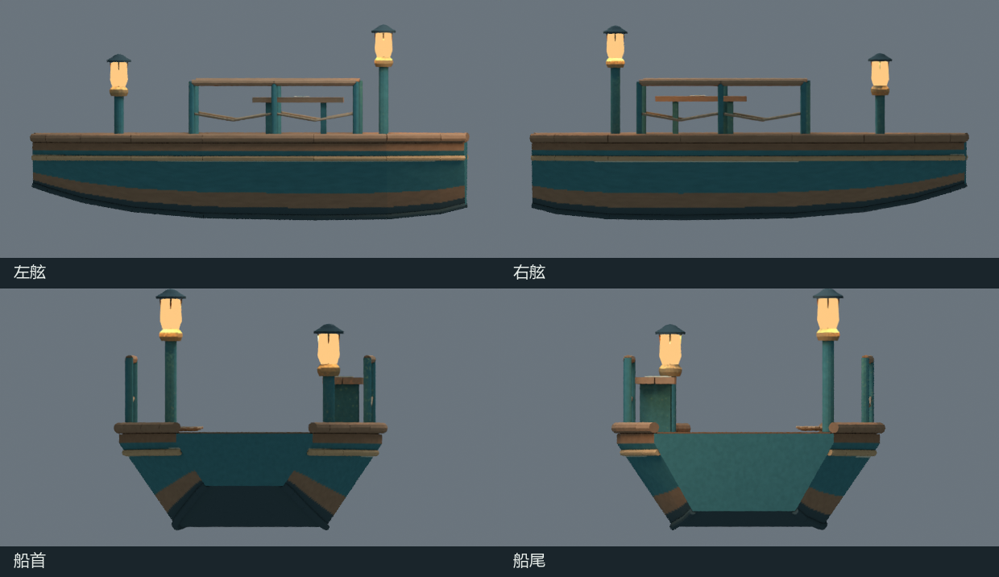

# 码头与末班船

船尾有一盏高灯，旁边盘着系船绳。另一侧座沿上放了一张空白三格卡。低灯标记船头，甲板中线贯通，两端均可上下船。独立模型使用米制 Unity 坐标，+z 指向船头。

| 资源与用途 | 相对 n9 的位置 (x, y, z) | 接口 |
| --- | --- | --- |
| [中央跳板](./harbor-pier.glb) | (0, 0, 0) | 走板顶面 y=0.007，铺板范围 z=-0.178 至 1.858，宽 1.86 m。与旧石板重叠 0.38 m。 |
| [中央船](./harbor-boat.glb) | (0, 0, 3.72) | 甲板 y=0，首末两端的铺板取船局部 z=±2.118。尾端与中央跳板重叠约 0.26 m。 |
| 早市船、暮路船 | (-11, 0.015, 7.55)、(11, 0.015, 7.55) | 同一船资源各实例化一次。与起点 z=20.2 的岸道各搭接约 0.27 m；1.5 cm 高差避免交叠甲板闪烁。 |
| [扩展水面 SCAD](./scene.scad) | (0, 0, 0) | 以 n9 为原点装配。沿旧水面外缘接出三块暗水，水面在 y=-0.70。 |

固定光照接入对象为船的 `FerryTimber` 和跳板的 `PierTimber`（单网格实例可能折叠为 `Model`）。`BowGlass` 与 `SternGlass` 独立采用实时材质。船局部灯芯坐标为船头 (-0.65, 0.66, 1.27)、船尾 (0.65, 0.94, -1.30)。玻璃节点的网格顶点已经含局部偏移，给灯光定位时使用上述船体坐标。

## 烘焙与本地检查

[Blender 母版](./harbor-master.blend) 保存原始材质、两盏油灯辅助光、窗光、天光和共同遮挡几何。用 Blender 5.3 执行 `--background --factory-startup --python build_harbor.py` 可重建母版、固定光照贴图与 GLB。Cycles 烘焙漫反射颜色、直接照明和间接照明，96 采样、3 次漫反射反弹。水面与两块灯罩保留运行时光照。

已重新读取两个 GLB，检查固定网格 UV0，并逐字节核对嵌入的 PNG 与独立烘焙 PNG 一致。船 1024×1024，跳板 768×768。GLB 的 SHA256 分别为 `149034d66abd361707ff3bd44d9285123fc5ca55d65e73a73db27e7d04b051bf` 和 `6c5cb2d2b94e8db10fe453f4f5f0ba3af535838ad68b1fd544e2b7a34740479a`。

从交付 GLB 的实际三角面沿甲板中线和两侧各 0.28 m 处，每 2 mm 射线采样一次。六条线的最大无板面区段均为 6 mm，来自木板间的留缝。[几何采样结果](./harbor-walk.json)

下图为第一版的中央泊位，展示甲板接缝与灯芯位置。编辑器玩家视角、移动输入、返航逻辑见 03 的整体验收。

### 船壳修订

首版每舷的 80 个三角面中有 56 个朝内，背面裁剪会使大片船板消失。现将船壳改为横断面共用顶点的封闭网格，并重烘船体。烘焙船体时隐藏中央跳板，三处泊位复用渡船时船尾均能显示木材本色。执行制作命令时追加 `-- boat` 可单独导出船。

[实际 GLB 检查](./check_boat.py)核对了 252 个三角面全都朝外，378 条壳边各连接两个面，首尾、顶底闭合，所有壳面均有有效 UV 面积。下图从交付 GLB 重新导入，使用背面透明的材质，从与甲板接近的高度检查两舷及首尾。

